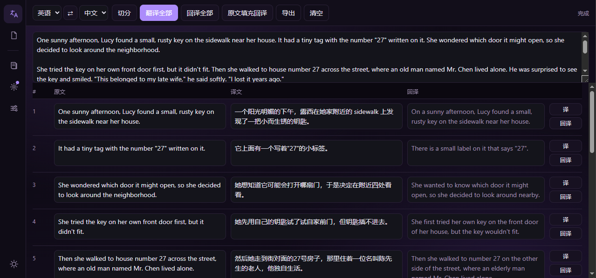
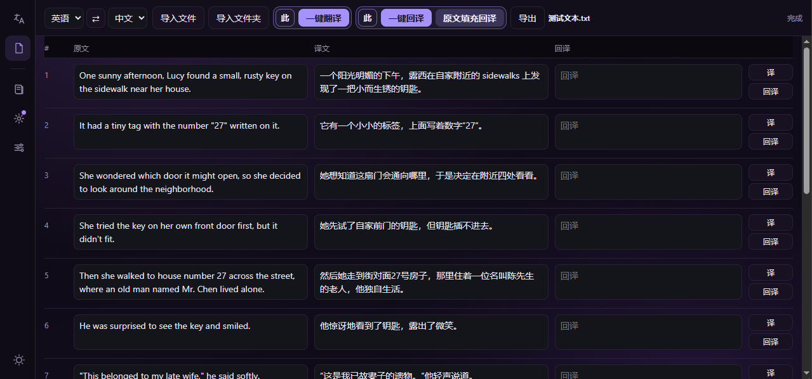

# 译环 · TransLoop

## 一个本地运行的轻量化翻译工作台，接入任意大模型 OpenAI 兼容的 api 即可开始翻译。
## 支持在翻译时修改译文，并将译文回译成源语言。
- 适用场景：
  - 模型训练时的标签优化
  - 外文文章修改
  - 长文本翻译任务
  - etc.

- 部署地址：
  - 本地部署打开 <http://127.0.0.1:8090> 。
  - 在线版为本 GitHub pages 部署，点击[译环 · TransLoop](https://reinlink.github.io/TransLoop/)即可打开。
- 模型接口：任何 OpenAI 兼容接口，默认接入本机运行的 llama-swap（`http://127.0.0.1:8081/v1`），亦可接入第三方提供商的模型，本地 llama-swap 需自行部署。

# 示例图




---

## 一、启动

启动界面：

```powershell
cd C:\Example\Path\TransLoop
node serve.mjs
```

停止界面：关掉对应的 node 进程即可。

---

## 二、界面结构

左侧的侧边栏，分隔线以上是翻译模式的选择，分割线以下是工具：

| 名称 | 说明 |
|---|---|
| 普通翻译 | 主界面，输入或粘贴文本即可翻译 |
| 文件翻译 | 以批量文件模式翻译 |
| 术语表 | 设置固定译法 |
| API 配置 | 设置接口、密钥、模型、配置档案 |
| 杂项设置 | 生成参数、提示词、分段方式、导出样式 |
| 主题 | 跟随系统 / 亮色 / 暗色 |

---

## 三、文本模式

1. 顶栏选源语言和目标语言（中/英/日/韩/俄，可交换）
2. 粘贴内容到上方输入框
3. 点「切分」按当前分段方式切分，或直接「翻译全部」
4. 表格里三列都可编辑：原文 / 译文 / 回译
5. 每行右侧有「译」和「回译」按钮，可单条翻译和重跑

快捷键：输入框里 **Ctrl+Enter** = 翻译全部。

### 分段方式（设置里切换）

- **原始分段**（默认）：按原文的行切，一行一条，适合提示词、打标词表
- **逐句分段**：按句子切，一句一条，适合只有大整段的长文章

### 逐句分段时的缩写处理

英文句子切分默认会把 `Mr. Chen` 拆成两句，已内置缩写规则规避：

- **无条件合并**：称谓与头衔 `Mr. Mrs. Ms. Dr. Prof. Rev. Hon. Gen. Col. Capt. Lt. Sgt. Gov. Sen. Rep. Pres. Jr. Sr. St. Mt.`
- **看下一句首字母**（小写/数字才合并）：月份 `Jan.–Dec.`、星期 `Mon.–Sun.`、美国州名缩写 `Calif. Fla. Tex. D.C.` 等、拉丁缩写 `etc. vs. No. e.g. i.e. a.m. p.m.`、学位 `Ph.D. M.D. B.A. M.A.`、公司 `Co. Inc. Ltd.`、度量衡 `in. ft. lb. oz. p. pp. approx.`、`Fig. Vol. Ch.`
- **人名首字母**：`J. K. Rowling` 这类单字母点号，后接大写时合并
- **编号**：`1. 2.` 这类列表编号与后文合并
- **国名缩写**：`U.S. U.K. U.N. E.U.` 后接大写也合并

想加新缩写：改 `TransLoop\app.js` 里的 `ABBREV_ALWAYS`（无条件）、`ABBREV_CONDITIONAL`（谨慎，看后文）或 `ABBREV_DOTTED_ALWAYS` 三个集合即可，不用改逻辑。

### ComfyUI 语法保护

开启后，以下内容在送模型前替换成占位符，译后回填，避免被翻译或破坏：

`<lora:名字:权重>`、`<lyco:…>`、`<hypernetwork:…>`、`(tag:1.2)`、`[a|b]`、`BREAK`、`AND/ADDROW/ADDCOL/ADDBASE`

模型若把占位符弄丢，会自动带提示重试一次；仍失败则该行标记「占位符丢失」。

### 回译

- 「回译全部」：把每行译文反向译回源语言，写入回译列
- 「原文填充回译」：**不调模型**，只给回译栏为空的句子填上原文；已有回译保持不变

回译只用于对照校验，不会覆盖原文。

---

## 四、文件模式

1. 切到「文件」，点「导入文件」、「导入文件夹」或直接把 文件/文件夹 拖进窗口
2. 支持 `.txt` / `.md` / `.srt` / `.vtt`
3. 顶栏按钮：

| 区域 | 内容 |
|---|---|
| 导入 | 导入文件 / 导入文件夹 |
| 翻译组 | `此/全` 切换 + 一键翻译 |
| 回译组 | `此/全` 切换 + 一键回译 + 原文填充回译 |
| 导出 | 导出（当前文件）/ 导出全部（ZIP，保留目录结构） |

**两个 `此/全` 互相独立：控制该组作用于「当前文件」还是「全部文件」，状态会保留。**

4. 顶栏最右侧显示当前文件名
5. 文件库
  - 侧边栏右缘中部的 `›` 打开（文件数 ≥2 时才出现），可切文件、单个删除（×）、清空。
  - 「导入文件」选多个文件；「导入文件夹」整个目录导入，保留相对路径
  - 也可以直接把文件/文件夹拖进窗口
  - 目录结构用树形展示，点文件夹可折叠/展开，折叠状态会记住
  - 文件右侧显示 `已译/总数`，悬停出现 × 删除；顶部「清空」删全部
  - 单个上限 300 个文件（localStorage 容量保护），超出会截断并提示
6. 导入过滤（防止误选大目录卡死）
  - 只读取文本类文件：`.txt` `.md` `.markdown` `.srt` `.vtt`，其余（图片、视频、压缩包、html 等）**一律跳过**，导入结束会提示「跳过 N 个非文本/超大文件」
  - 单个文件上限 **2 MB**，超出跳过
  - 单次/累计上限 **300 个文件**
  - 浏览器存储写满时会提示「浏览器存储已满」，此时删掉部分文件再导入

---

## 五、设置项

### API

| 项 | 说明 |
|---|---|
| 配置 | 可保存多套接口配置，下拉切换；旁边有 保存为预设、删除当前预设 两个功能按钮 |
| 接口地址 | 默认 `http://127.0.0.1:8081/v1`，可填任何 OpenAI 兼容地址 |
| 密钥 | 需要鉴权的服务填这里，若用本机 llama-swap 留空 |
| 模型 | 点 ↻ 从 `/v1/models` 中重新拉取模型 |
| 测试连接 | 成功显示模型数，失败在竖栏按钮上亮红点并弹气泡 |

### 设置

| 项 | 说明 |
|---|---|
| 温度 | 翻译建议 0.1–0.3；1 或以上会开始自由发挥 |
| Top-P | 建议 0.9 |
| 最大输出 token | 单条译文的长度上限，长句/长段要调大 |
| 并发请求 | 一般 1–2 就行，实际情况可根据 RPM 限制调整 |
| 系统提示词 | 支持 `{sourceLang}` `{targetLang}` 占位符，会按当前语言替换 |
| 分段方式 | 原始分段 / 逐句分段 |
| ComfyUI 语法保护 | [见上文](#ComfyUI-语法保护) |
| 导出样式 | 成段导出 / 逐句导出 |

---

## 六、导出规则

点「导出」弹出勾选：原文 / 译文 / 回译。拼接顺序按勾选自动匹配：

| 勾选 | 输出顺序 |
|---|---|
| 原文 | 原文 |
| 译文 | 译文 |
| 回译 | 回译 |
| 原文 + 译文 | 原文 → 译文 |
| 原文 + 回译 | 原文 → 回译 |
| 译文 + 回译 | 回译 → 译文 |
| 三项全选 | 原文 → 译文 → 回译 |

- **成段导出**：按导入时的原始行分组，行内句子首尾相连，保留原换行与空行（只导原文时与原文逐字节一致）
- **逐句导出**：每句独立成段，段间空一行
- 文件名：文本模式 `translation.txt`，文件模式沿用原文件名
### 导出校验

**「导出」（当前文件/文本模式）与「导出全部」用同一套判定，只是范围不同：**

**导出：**
- 所选列**有空白** → 弹出 **二次确认按钮**，并列出空位
  - 点击按钮 → 只导出所选类别都填满的片段（导出单文件）/只打包导出选中的类别都填满的文件（导出全部）
  - 点击空白处 → 取消本次导出
- 全部填满 → 直接导出/打包导出

**如果某一段的 *原文、译文、回译三项都为空* ，视为把这段删掉：**

- 导出校验时直接跳过该段，不会弹警示
- 导出结果里也不会出现这段的空行

---

## 七、数据保存

数据全部存在浏览器 `localStorage`（键 `lt.workbench.v2`，草稿在 `lt.workbench.v2.draft`）：

- 换浏览器、清站点数据 → 设置与内容清空
- 术语表支持 CSV 导入/导出，可跨浏览器搬运
- 文件内容也存在 localStorage，超大文件可能触顶（5MB 量级），建议分批

---
## 八、中断与断点接续

- 处理中顶栏会出现「中断」按钮，点击后不再发新请求，已收到的结果保留
- 每个段落记有「参数 + 方向 + 原文」指纹，下次同样的请求会跳过已完成且未改动的段落
- 所以中断后再点一次「一键翻译/一键回译」就是续跑，不会重复消耗
- 改动原文、换模型、改温度/提示词/术语表开关，指纹会变，要重新翻译

## 九、常见问题

| 现象 | 处理 |
|---|---|
| 竖栏 API 按钮亮红点、气泡提示未连接 | 模型服务地址、api 密钥填错，或是本地服务未启动 |
| 顶部状态显示"原样返回" | 模型没执行翻译，重 roll 或者换更强的模型 |
| 翻译很慢 | 模型提供商问题或是本地首次请求要加载模型（10–30 秒）；并发调高反而更慢 |
| 长文被截断 | 调大「最大输出 token」，或改用逐句分段 |
| 设置丢了 | 清了站点数据或换了浏览器；术语表请用 CSV 备份 |

---

## 十、文件结构

```
TransLoop\
├─ index.html   界面结构
├─ styles.css   主题与布局
├─ app.js       全部逻辑（分段、翻译、回译、术语、导出）
├─ serve.mjs    静态服务（127.0.0.1:8090）
└─ README.md
```
